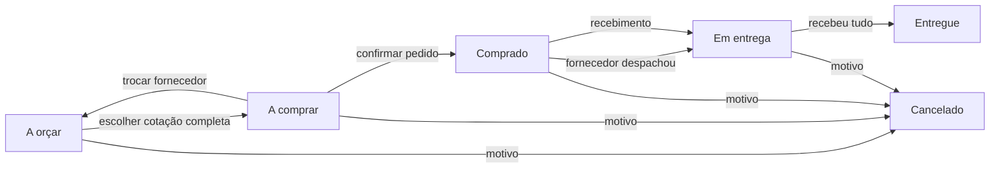

# Compras

Aba **Compras** (permissão “Compras e suprimentos”). Responde a três perguntas: o que a obra precisa e ainda não foi comprado, de quem comprar e quando o material chega.

## Fluxo

1. **Pedido de compra** (`PC-0001`, numeração por empresa): nome, obra, data em que a obra precisa, prioridade, endereço de entrega e itens. Os itens vêm do cadastro de produtos, avulsos, ou copiados de um orçamento da empresa (itens de primeiro nível, com o custo do orçamento como referência — exige leitura em Orçamentos).
2. **Cotações**: uma por fornecedor e pedido. Preço unitário por item (item sem preço fica de fora), prazo de entrega em dias, condição e prazo médio de pagamento, frete, desconto, validade, abertura para negociar (1 a 5) e observações da negociação. Reenviar substitui, não duplica.
3. **Comparativo**: matriz item × fornecedor com o menor preço de cada item destacado, total com frete e desconto, data de chegada se o pedido sair hoje e se ela chega antes da necessidade da obra, diferença para a referência (GOINFRA, SINAPI ou biblioteca) e uma nota de 0 a 100 — preço 45%, prazo de entrega 30%, negociação 15%, prazo de pagamento 10%. Só concorre cotação completa e dentro da validade. A recomendada é a de maior nota entre as que chegam a tempo. Também mostra quanto custaria comprar cada item do mais barato (sem frete).
4. **Escolha → pedido**: confirmar o pedido congela o total da cotação escolhida (`purchased_total_cents`) e calcula a previsão de entrega pelo prazo da cotação (editável). Depois disso itens e cotações não mudam. Corrigir a cotação escolhida antes do pedido devolve o pedido à escolha.
5. **Logística**: saída do fornecedor (transportadora ou veículo, rastreio ou placa, nova previsão), atualização da previsão, recebimento parcial ou total por item com data e observação (avaria, falta, troca). Receber mais do que foi comprado é recusado.
6. **Entregas**: atrasadas, chegam em até 7 dias, depois ou sem previsão — com fornecedor, transporte e endereço.

A linha do tempo do pedido registra cada passo com autor e hora; toda escrita também entra na auditoria da empresa.

## Fornecedores

Cadastro com CNPJ/CPF (único por empresa), contato, cidade/UF, o que fornece, condição de pagamento e prazo usuais e abertura para negociar — os três últimos viram sugestão ao lançar cotação. O cartão mostra o histórico real: cotações, compras ganhas, entregas no prazo, prazo real médio entre pedido e entrega e total comprado. Fornecedor é desativado, nunca apagado.

## Produtos

- **Manual**: nome, código, categoria, unidade, marca, especificação e custo de referência opcional.
- **Do catálogo**: busca na GOINFRA, na SINAPI (referência aprovada da UF) ou na biblioteca de orçamentos da empresa. A tela envia só a referência; descrição, unidade e custo são lidos no servidor. Importar de novo devolve o mesmo produto.
- O histórico de preços mostra o que cada fornecedor cotou para o produto.

## GOINFRA

A Agência Goiana de Infraestrutura e Transportes publica a tabela de preços no próprio site, em planilha, sem API. O superadministrador baixa a planilha oficial e envia em **Painel da plataforma → Referência GOINFRA** (XLSX ou CSV, até 30 MB), escolhendo tabela (obras civis ou rodoviária), regime (desonerada ou não) e referência (mês).

- As colunas são achadas pelo **nome** do cabeçalho (código, descrição, unidade e preço unitário), nas 30 primeiras linhas de cada aba; título de grupo, subtotal e rodapé são ignorados e contados.
- Uma tabela ativa por tipo e regime. A nova entra em separado e só troca de lugar com a anterior no fim, num único lote: quem busca durante a importação vê a tabela antiga inteira. Referência mais antiga que a ativa é recusada.
- O registro guarda arquivo, SHA-256, aba, contagens, quem importou e quando.
- Produto criado de uma tabela que depois foi substituída mantém o custo e o rótulo de onde veio; buscar de novo traz o preço vigente.

**Pendente:** homologar com a planilha real da GOINFRA. O ambiente de desenvolvimento não alcança o site da agência, então o leitor foi construído pelo layout usual (código, descrição, unidade, preço) e testado com uma planilha de teste. Se a planilha oficial não for reconhecida, a importação é recusada com o motivo e as abas encontradas — nunca grava preço lido da coluna errada.

## Integração com o resto da plataforma

- **Obras e projetos**: todo pedido pode ser ligado a uma obra da empresa; o quadro e as entregas filtram por obra.
- **Orçamentos**: cópia dos itens de um orçamento para um pedido; biblioteca de orçamentos como catálogo de produtos.
- **SINAPI e GOINFRA**: catálogo e preço de referência do comparativo.
- **Lembretes do dia**: compra ainda não feita com necessidade nos próximos 7 dias, e entrega prevista ou atrasada. Somem sozinhos quando o pedido sai, chega ou é cancelado.
- **Financeiro**: a Drap continua sendo a fonte financeira. Compras não cria conta a pagar nem lançamento; o “comprado a receber” é a soma dos pedidos em andamento, não saldo.

## Permissões

| Perfil | Padrão |
| --- | --- |
| Contratante, administrador | ver e editar |
| Gestor | ver e editar |
| Financeiro, contabilidade, colaborador | ver |
| Parceiro, prestador, RH | sem acesso |

Contas com permissões já personalizadas não ganham o módulo sozinhas: o administrador libera em Equipe.

## Fora desta entrega

- Envio automático do pedido de cotação ou do pedido ao fornecedor (e-mail/WhatsApp).
- Lançamento da compra como conta a pagar na Drap.
- Estoque e consumo por obra depois do recebimento.
- Download automático da tabela GOINFRA.
