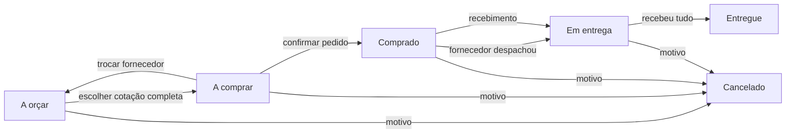

# Compras

Aba **Compras** (permissão “Compras e suprimentos”). Responde a três perguntas: o que a obra precisa e ainda não foi comprado, de quem comprar e quando o material chega.

## Fluxo

1. **Pedido de compra** (`PC-0001`, numeração por empresa): nome, obra, data em que a obra precisa, prioridade, endereço de entrega e itens. Os itens vêm do cadastro de produtos, avulsos, ou copiados de um orçamento da empresa (itens de primeiro nível, com o custo do orçamento como referência — exige leitura em Orçamentos).
2. **Cotações**: uma por fornecedor e pedido. Preço unitário por item (item sem preço fica de fora), prazo de entrega em dias, condição e prazo médio de pagamento, frete, desconto, validade, abertura para negociar (1 a 5) e observações da negociação. Reenviar substitui, não duplica.
3. **Comparativo**: matriz item × fornecedor com o menor preço de cada item destacado, total com frete e desconto, data de chegada se o pedido sair hoje e se ela chega antes da necessidade da obra, diferença para a referência (GOINFRA, SINAPI ou biblioteca) e uma nota de 0 a 100 — preço 45%, prazo de entrega 30%, negociação 15%, prazo de pagamento 10%. Só concorre cotação completa e dentro da validade. A recomendada é a de maior nota entre as que chegam a tempo. Também mostra quanto custaria comprar cada item do mais barato (sem frete).
4. **Escolha → pedido**: confirmar o pedido congela o total da cotação escolhida (`purchased_total_cents`) e calcula a previsão de entrega pelo prazo da cotação (editável). Depois disso itens e cotações não mudam. Corrigir a cotação escolhida antes do pedido devolve o pedido à escolha.
5. **Logística**: saída do fornecedor (transportadora ou veículo, rastreio ou placa, nova previsão), atualização da previsão, recebimento parcial ou total por item com data e observação (avaria, falta, troca). Receber mais do que foi comprado é recusado.
6. **Entregas**: atrasadas, chegam em até 7 dias, depois ou sem previsão — com fornecedor, transporte e endereço.

A linha do tempo do pedido registra cada passo com autor e hora; toda escrita também entra na auditoria da empresa.

## Fornecedores

Cadastro com CNPJ/CPF (único por empresa), contato, cidade/UF, o que fornece, condição de pagamento e prazo usuais e abertura para negociar — os três últimos viram sugestão ao lançar cotação. O cartão mostra o histórico real: cotações, compras ganhas, entregas no prazo, prazo real médio entre pedido e entrega e total comprado. Fornecedor é desativado, nunca apagado.

## Fornecedores reais: Receita Federal e lista de preços da loja

- **CNPJ na Receita**: no cadastro, o botão **Receita** consulta o CNPJ (dados abertos da Receita Federal, pela BrasilAPI) e preenche nome, cidade, UF, telefone, e-mail e atividade para a pessoa conferir. Depois de salvo, **Conferir CNPJ na Receita** grava razão social, situação cadastral e data da conferência — consulta feita pelo servidor, nunca vinda do navegador. CNPJ baixado, suspenso ou inapto aparece em vermelho no cartão. Dígito verificador errado nem chega a consultar; consulta indisponível, CNPJ inexistente ou resposta de outro CNPJ voltam como erro, sem preencher nada.
- **Lista de preços da loja**: a planilha que o fornecedor envia (XLSX ou CSV, colunas achadas pelo nome — descrição ou produto, unidade e preço; código opcional), com a data dos preços. Até 3.000 itens por fornecedor; a nova substitui a anterior inteira, num lote só. Os itens aparecem no catálogo (aba **Listas das lojas**), viram produto com o preço da loja e entram nas sugestões de fornecedor com o preço e a data da lista.

**Pendente:** a consulta de CNPJ foi testada com a resposta da BrasilAPI simulada; o ambiente de desenvolvimento não alcança o serviço. Conferir ao vivo na primeira consulta em produção.

## Produtos

- **Manual**: nome, código, categoria, unidade, marca, especificação e custo de referência opcional.
- **Materiais padrão**: 59 materiais de mercado (cimentos, cal, agregados, concreto usinado, vergalhões CA-50/CA-60 com massa nominal, tela soldada, blocos cerâmicos e de concreto, argamassas, revestimento, telhas, manta, tubos de PVC, caixa d'água, louça, cabos, eletroduto, disjuntor, tomadas, drywall e tinta), cada um com a norma ABNT que o define e a especificação a pedir. **Não têm preço**: preço muda por mês, praça e loja, e vem da SINAPI, da GOINFRA ou da lista da loja. A edição vigente de cada norma deve ser conferida no catálogo da ABNT, como os parâmetros normativos do CAD. Lista em `lib/catalogo-materiais.ts`.
- **Do catálogo**: busca nos materiais padrão, nas listas de preços das lojas, na GOINFRA, na SINAPI (referência aprovada da UF) ou na biblioteca de orçamentos da empresa. A tela envia só a referência; descrição, unidade e custo são lidos no servidor. Importar de novo devolve o mesmo produto.
- O histórico de preços mostra o que cada fornecedor cotou para o produto.

## Estoque

Aba **Estoque** dentro de Compras. O saldo é a soma dos movimentos por produto e local — cada obra tem o seu, e há o **Depósito central** — e não fica guardado em separado.

- **Entrada automática**: receber material de um pedido (total ou em parte) lança a entrada no local do pedido, pelo preço da cotação comprada, no mesmo lote que marca o item como recebido. Item avulso, sem produto cadastrado, não entra no estoque.
- **Entrada manual**: sobra de outra obra, compra no balcão, doação — com custo opcional.
- **Baixa**: material aplicado, perdido ou devolvido, com o destino obrigatório (serviço, frente ou motivo). A baixa nunca deixa saldo negativo: a conferência do saldo e a gravação são a mesma instrução, então duas baixas simultâneas não passam juntas.
- Reenviar o mesmo formulário depois de falha de rede não lança o movimento duas vezes (chave do formulário).
- **Estoque mínimo** por produto e local; zero desliga o aviso.

### Atenção

No topo da aba, e em **Lembretes do dia**:

- **Em falta** (saldo zerado) e **abaixo do mínimo**, dizendo se há compra aberta para aquele local e em que pé ela está;
- **Sem previsão de entrega**: pedido comprado sem data de chegada;
- **Entrega atrasada**: previsão vencida.

Os pedidos sem previsão também aparecem marcados no quadro e nas entregas.

### Outros fornecedores possíveis

Cada item de atenção e o detalhe do pedido (em “A orçar”, ou com entrega atrasada, sem previsão ou depois da necessidade) mostram até quatro fornecedores, com telefone e e-mail:

1. quem já cotou o mesmo produto para a empresa, com o último preço e prazo que deu — ordenado por entregas no prazo e depois por preço;
2. quem tem item parecido na lista de preços que enviou (as duas palavras mais longas do material, sem diferença de acento), com o preço e a data da lista;
3. quem declara no cadastro que fornece aquele material ou a categoria inteira do produto.

O fornecedor atual e quem já cotou o pedido ficam de fora. Sem histórico nem categoria parecida, a lista vem vazia e a tela diz isso — nenhuma indicação é inventada.

## GOINFRA

Tabelas oficiais da Agência Goiana de Infraestrutura e Transportes, publicadas em [goias.gov.br/goinfra](https://goias.gov.br/goinfra/tabelas/) em XLS (Excel 97), por data-base bimestral, com e sem desoneração:

| Tipo na plataforma | Publicação da GOINFRA | Preço usado |
| --- | --- | --- |
| Materiais (insumos) | Custo Referencial de Materiais | Custo Unitário |
| Mão de obra (insumos) | Custo Referencial de Mão de Obra | Valor com encargos |
| Serviços de obras civis | Relatório Sintético de Composições (Tabela 3xx) | Total (material + mão de obra) |
| Rodoviária | — (só envio manual) | — |

**Busca automática.** A atualização de hora em hora (`/api/cron/banco`, ver [Atualizar o banco](ATUALIZAR-BANCO.md)) confere o site no máximo uma vez a cada 20 horas, depois de o esquema estar em dia. Para cada tipo, acha a página pelo índice ("Tabela de Insumos", "Tabela de Preços"), lê a lista de arquivos, escolhe o mais recente de cada regime pelo nome ("FEVEREIRO-2026 - SEM DESONERAÇÃO") e baixa só se for mais novo que o ativo. Só baixa de `goias.gov.br/goinfra/wp-content/uploads/`; endereço de outro site na página é ignorado. Falha numa tabela não impede as outras e fica registrada no painel.

**Conferência.** A data-base e o regime também vêm do cabeçalho da própria planilha ("T334 - FEVEREIRO/2026 - SEM DESONERAÇÃO", "Data base: 01/02/2026"). Arquivo que diz outra data-base ou outro regime é recusado. As colunas são achadas pelo nome do cabeçalho; linhas de título de grupo (sem unidade ou "S/U") e rodapé ficam de fora e são contadas.

**Painel do superadministrador → Referência GOINFRA:** tabelas ativas (arquivo, SHA-256, itens, quem importou), **Buscar no site da GOINFRA agora**, a última conferência automática e o envio manual do arquivo oficial (XLS, XLSX ou CSV) para quando o site não responder à plataforma.

**Homologação (13/11/2026).** Lidas e importadas do site real as seis tabelas de data-base fevereiro/2026 (publicadas em 05/05/2026): materiais T334/T333 com 1.817 itens cada, mão de obra com 29 itens cada e serviços de obras civis com 1.956 itens cada. O leitor de XLS foi comparado célula a célula com uma biblioteca de referência nas duas maiores planilhas (19.427 células, nenhuma diferença). A busca a partir da Vercel depende de o site da GOINFRA aceitar conexão do servidor publicado; se recusar, o painel mostra a falha e o envio manual continua valendo.

Uma tabela ativa por tipo e regime; a nova entra em separado e troca de lugar com a anterior no fim, num lote só. Produto criado de uma tabela que depois foi substituída mantém o custo e o rótulo de onde veio; buscar de novo traz o preço vigente.

## Integração com o resto da plataforma

- **Obras e projetos**: todo pedido pode ser ligado a uma obra da empresa; o quadro e as entregas filtram por obra.
- **Orçamentos**: cópia dos itens de um orçamento para um pedido; biblioteca de orçamentos como catálogo de produtos.
- **SINAPI e GOINFRA**: catálogo e preço de referência do comparativo.
- **Lembretes do dia**: compra ainda não feita com necessidade nos próximos 7 dias, entrega prevista, atrasada ou sem previsão, e material em falta ou abaixo do mínimo. Somem sozinhos quando o pedido sai, chega ou é cancelado.
- **Financeiro**: a Drap continua sendo a fonte financeira. Compras não cria conta a pagar nem lançamento; o “comprado a receber” é a soma dos pedidos em andamento, não saldo.

## Permissões

| Perfil | Padrão |
| --- | --- |
| Contratante, administrador | ver e editar |
| Gestor | ver e editar |
| Financeiro, contabilidade, colaborador | ver |
| Parceiro, prestador, RH | sem acesso |

Contas com permissões já personalizadas não ganham o módulo sozinhas: o administrador libera em Equipe.

## Fora desta entrega

- Envio automático do pedido de cotação ou do pedido ao fornecedor (e-mail/WhatsApp).
- Lançamento da compra como conta a pagar na Drap.
- Transferência direta entre locais (hoje: baixa num local e entrada no outro).
- Inventário com contagem física e ajuste.
- Download automático da tabela GOINFRA.
- Fornecedores e preços pré-cadastrados: a plataforma não semeia lojas nem preços. Cada empresa cadastra as lojas com que trabalha (com a conferência da Receita) e importa as listas que elas enviam.
